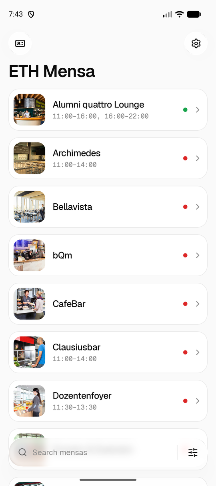
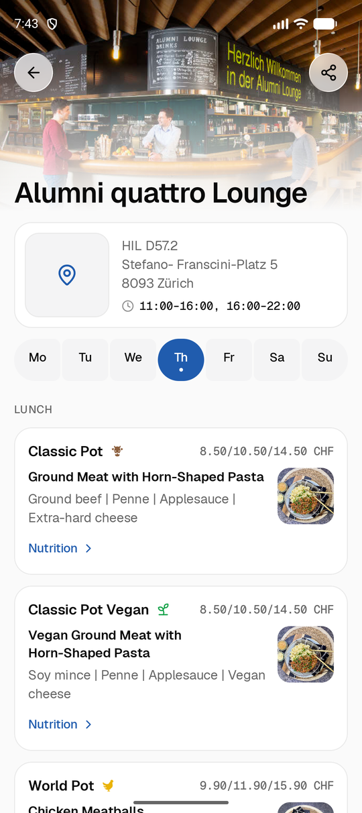

# Mensa Zürich

An unofficial Android app for the menus of the ETH Zürich and UZH mensas, with a Wear OS app and a home-screen widget.

It is a Kotlin and Jetpack Compose port of [ETH Mensa for iOS](https://github.com/alexandrereol/ethmensa) by Alexandre Reol. It is not affiliated with that app, its author, ETH Zürich, UZH or ZFV.

<p align="center">
  
  
  
</p>

## Features

- Weekly menus of the ETH and UZH mensas, with photos, allergens, nutrition and prices for students, staff and external guests
- Smart sorting, filters by campus, status and diet, favorites and hidden mensas
- This week and next week (as soon as the mensas publish it)
- Opening hours and address of each mensa, one tap to open it in your maps app
- Menu reminders, optionally only when you're on campus
- The ETH Legi card in the app, from a Quick Settings tile or by long-pressing the app icon
- "Today's menu" home-screen widget
- Wear OS app that works without the phone
- English, German, French and Italian, light and dark mode
- No tracking or analytics

## Install

### With Obtainium

[Obtainium](https://github.com/ImranR98/Obtainium) installs the app from this repository's GitHub releases and keeps it up to date.

1. This repository is private, so create a GitHub [fine-grained personal access token](https://github.com/settings/personal-access-tokens/new) with read-only access to *Contents* of `mrghxst/ethmensa`.
2. In Obtainium, tap *Add app* and enter `https://github.com/mrghxst/ethmensa`.
3. Under the GitHub options, paste the token as the *GitHub credentials* (personal access token).
4. Set *Filter APKs by regular expression* to `^mensa-zurich-\d` so Obtainium picks the phone APK and not the watch APK.
5. Tap *Add* and install.

### Manually

Download `mensa-zurich-<version>.apk` from the [latest release](https://github.com/mrghxst/ethmensa/releases/latest) and open it on the phone, or install it from a computer:

```bash
adb install -r mensa-zurich-1.0.0.apk
```

For the watch, connect it with wireless debugging and install `mensa-zurich-wear-<version>.apk` the same way.

The app needs Android 10 or later, the watch app Wear OS 3 or later.

## Build

You need JDK 21 and the Android SDK (platform 37, build-tools 37).

1. Create `android/local.properties` with `sdk.dir=<path to the Android SDK>`.
2. Optional: set `ZFV_API_KEY=<key>` there. Without it, the build uses the shared public ZFV key that shows the UZH mensas.
3. Build from `android/`:

```bash
./gradlew :app:assembleDebug :wear:assembleDebug
```

Run the unit tests and lint with `./gradlew test lint`.

### Releasing

Release builds are signed with the key named in `android/local.properties` (`RELEASE_STORE_FILE`, `RELEASE_STORE_PASSWORD`, `RELEASE_KEY_ALIAS`, `RELEASE_KEY_PASSWORD`). Keep a backup of the keystore and its passwords: an installed app only accepts updates signed with the same key. Without these entries, release builds fall back to the debug key.

1. Raise `appVersionCode` and `appVersionName` in `android/build.gradle.kts` and commit.
2. Build: `./gradlew :app:assembleRelease :wear:assembleRelease`
3. Copy `app/build/outputs/apk/release/app-release.apk` to `mensa-zurich-<version>.apk` and `wear/build/outputs/apk/release/wear-release.apk` to `mensa-zurich-wear-<version>.apk`.
4. Publish them as a GitHub release tagged `v<version>`:

```bash
gh release create v1.0.1 mensa-zurich-1.0.1.apk mensa-zurich-wear-1.0.1.apk --title "Mensa Zürich 1.0.1" --notes "…"
```

Obtainium compares the tag with the installed version, so the tag must match `appVersionName`.

## Repository

| Path | What it is |
| --- | --- |
| `android/` | The Android app: `app` (phone), `wear` (watch), `core` (shared data and logic), `baselineprofile` |
| `android/PARITY.md` | Feature-by-feature comparison with the iOS app |
| `android/tools/` | Scripts that generate strings and icons |
| `ethmensa/`, `watchos/`, `widget/`, `clip/`, `ethmensa.xcodeproj/` | The original iOS app, unchanged, kept as the reference for the port |
| `ANDROID_PORT_PROMPT.md` | The specification the port was built from |

## Credits

- **[ETH Mensa for iOS](https://github.com/alexandrereol/ethmensa)** by Alexandre Reol, GPLv3. This app's features, texts and translations, the mensa data mapping and the reminder sound come from it.
- **Menus**: ETH Zürich (idapps.ethz.ch) and ZFV (api.zfv.ch) for the UZH mensas.
- **Icons**: [Lucide](https://lucide.dev) (ISC). **Font**: [Geist](https://vercel.com/font) (SIL OFL 1.1).
- The other open-source libraries are listed in the app under *Settings → Open-source licenses*.

## License

GNU General Public License v3.0 or later, like the iOS app it is based on. See [LICENSE](LICENSE).
