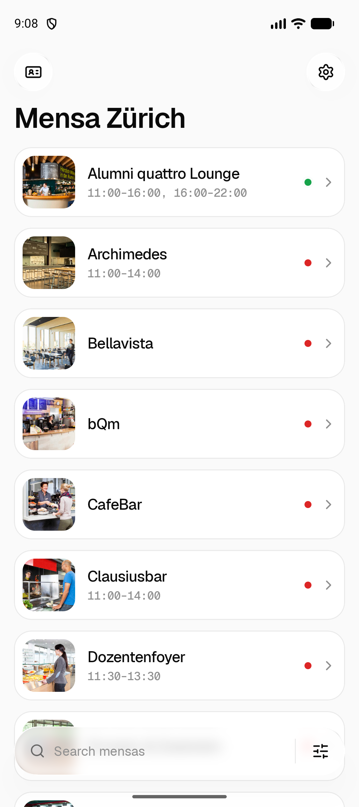
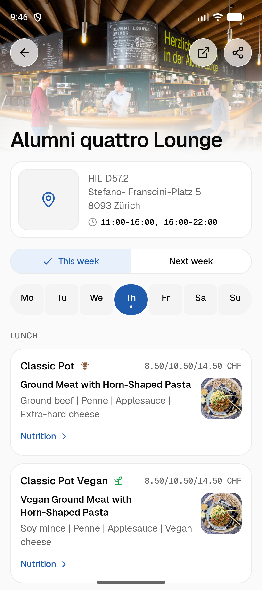
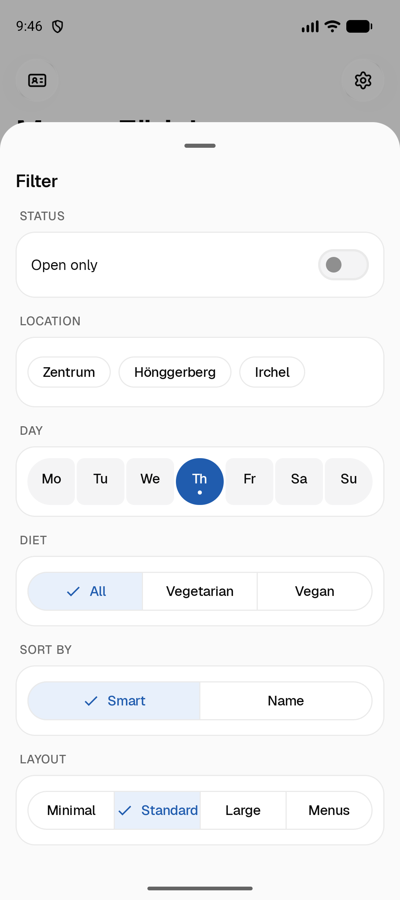
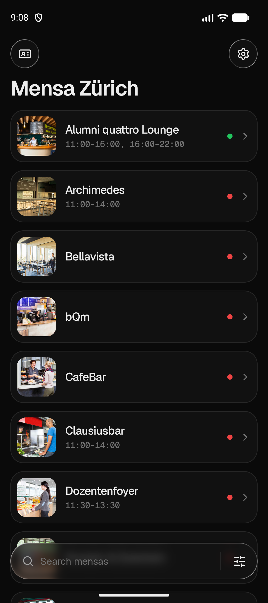

<p align="center">
  
</p>

<h1 align="center">Mensa Zürich</h1>

<p align="center">
  Menus of the ETH Zürich and UZH mensas on Android and Wear OS.<br>
  Unofficial, open source, no tracking.
</p>

<p align="center">
  <a href="https://mrghxst.github.io/mensa/"><b>Website</b></a> ·
  <a href="https://github.com/mrghxst/mensa-zurich/releases/latest">Download</a> ·
  <a href="https://mrghxst.github.io/mensa/privacy/">Privacy policy</a> ·
  <a href="https://mrghxst.github.io/mensa/terms/">Terms of use</a>
</p>

<p align="center">
  <a href="https://github.com/mrghxst/mensa-zurich/releases/latest"></a>
  <a href="https://github.com/mrghxst/mensa-zurich/actions/workflows/ci.yml"></a>
  <a href="LICENSE"></a>
  
</p>

<p align="center">
  
  
  
  
</p>

## Features

- **Menus** of all ETH and UZH mensas, with photos, allergens, nutrition and prices for students, staff and external guests
- **This week and next week**, as soon as the mensas publish it
- **Smart sorting** by what you open most, filters by campus, opening status and diet, favorites and hidden mensas
- **Opening hours**, address and a small map, one tap to open the mensa in your maps app
- **Reminders** before lunch, optionally only when you're on campus
- **Legi card** in the app, from a Quick Settings tile or by long-pressing the app icon
- **Widget** with today's menu of your favorite mensa
- **Wear OS app** that works without the phone
- English, German, French and Italian, light and dark mode, phones, foldables and tablets

## Install

Mensa Zürich isn't on Google Play. Install it from the [releases](https://github.com/mrghxst/mensa-zurich/releases).

### With Obtainium (recommended)

[Obtainium](https://github.com/ImranR98/Obtainium) installs the app from the GitHub releases and updates it.

1. In Obtainium, tap *Add app* and enter `https://github.com/mrghxst/mensa-zurich`.
2. Set *Filter APKs by regular expression* to `^mensa-zurich-\d` so it picks the phone app and not the watch app.
3. Tap *Add*, then *Install*.

### Manually

Download `mensa-zurich-<version>.apk` from the [latest release](https://github.com/mrghxst/mensa-zurich/releases/latest) and open it on your phone.

### Wear OS

Connect the watch with [wireless debugging](https://developer.android.com/training/wearables/get-started/debugging) and run:

```bash
adb install -r mensa-zurich-wear-1.0.1.apk
```

The phone app needs Android 10 or later, the watch app Wear OS 3 or later. Releases are signed with the same key, and the signing certificate's SHA-256 fingerprint is in each release's notes.

## Privacy

No accounts, no ads, no analytics, no tracking. Your settings stay on your device. Read the [privacy policy](https://mrghxst.github.io/mensa/privacy/) and the [terms of use](https://mrghxst.github.io/mensa/terms/); [PRIVACY.md](PRIVACY.md) lists every server the app talks to.

## Build from source

You need JDK 21 and the Android SDK with platform 37.

```bash
git clone https://github.com/mrghxst/mensa-zurich.git
cd mensa-zurich
./gradlew assembleDebug
```

The APKs land in `app/build/outputs/apk/debug/` and `wear/build/outputs/apk/debug/`. Run the unit tests and lint with `./gradlew test lint`.

The UZH menus come from the ZFV API. The build includes the shared public key; to use your own, set `ZFV_API_KEY=<key>` in `local.properties`.

### Project layout

| Path | Contents |
| --- | --- |
| `app/` | Phone app: Compose UI, widget, reminders, Legi card |
| `wear/` | Wear OS app |
| `core/` | Shared domain logic and data layer (ETH and ZFV APIs, caching, settings), with most unit tests |
| `baselineprofile/` | Generates the startup profile |
| `tools/` | Python scripts that generate strings and icons |
| `site/` | The website with the privacy policy and terms, published to [mrghxst.github.io/mensa](https://mrghxst.github.io/mensa/) |
| `docs/` | [Feature parity with the iOS app](docs/PARITY.md), the [original port specification](docs/port-spec.md), screenshots |

### Releasing

Release builds are signed with the key named in `local.properties` (`RELEASE_STORE_FILE`, `RELEASE_STORE_PASSWORD`, `RELEASE_KEY_ALIAS`, `RELEASE_KEY_PASSWORD`). Without it, they fall back to the debug key. Back up the keystore and its passwords: an installed app only accepts updates signed with the same key.

1. Raise `appVersionCode` and `appVersionName` in `build.gradle.kts`, add the changes to [CHANGELOG.md](CHANGELOG.md) and commit.
2. Build: `./gradlew :app:assembleRelease :wear:assembleRelease`
3. Copy the APKs to `mensa-zurich-<version>.apk` and `mensa-zurich-wear-<version>.apk`.
4. Publish them with the tag `v<version>`, which Obtainium compares with the installed version:

```bash
gh release create v1.0.1 mensa-zurich-1.0.1.apk mensa-zurich-wear-1.0.1.apk --title "Mensa Zürich 1.0.1" --notes-file notes.md
```

### Website

`site/` is a static website (no build step) with the landing page, the privacy policy and the terms of use. GitHub Pages serves it from the public repository [mrghxst/mensa](https://github.com/mrghxst/mensa), which only holds the contents of `site/`. To preview it, run `python -m http.server 8765 --directory site`. To publish a change, commit it here and run:

```bash
python tools/publish_site.py --push
```

The policy and terms are linked from the app (Settings → Privacy, and the first-launch screen), so keep their URLs stable.

## Contributing

Bug reports and pull requests are welcome. Please keep pull requests focused, run `./gradlew test lint` first, and check UI changes in light and dark mode.

## Credits

Mensa Zürich is a port of **[ETH Mensa for iOS](https://github.com/alexandrereol/ethmensa)** by Alexandre Reol and its contributors, licensed under GPLv3. Its features, texts and translations, the UZH mensa data and the reminder sound come from that app, and its history is preserved in this repository.

- Menus: [ETH Zürich](https://ethz.ch) and [ZFV](https://www.zfv.ch) (UZH mensas)
- Map: tiles from [OpenFreeMap](https://openfreemap.org), data © [OpenStreetMap](https://www.openstreetmap.org/copyright) contributors
- Icons: [Lucide](https://lucide.dev) (ISC). Font: [Geist](https://vercel.com/font) (SIL OFL 1.1)
- The other open-source libraries are listed in the app under *Settings → Open-source licenses*.

This app is not affiliated with ETH Zürich, the University of Zurich, ZFV or the iOS app.

## License

[GNU General Public License v3.0 or later](LICENSE).
